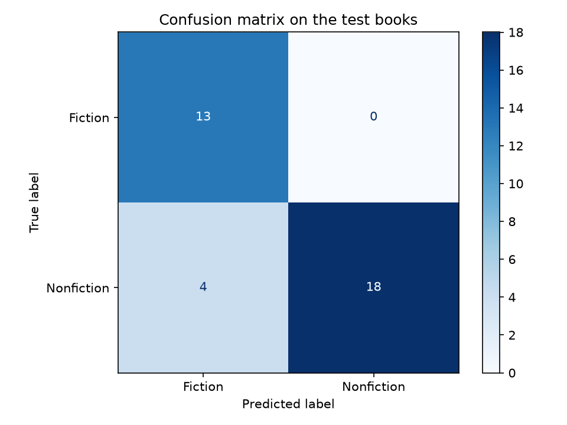
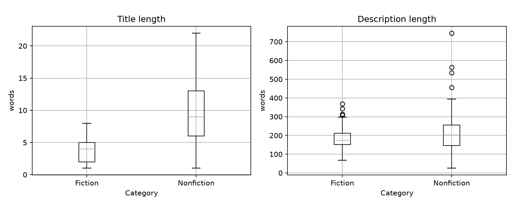

# Book Genre Classifier

An end-to-end machine learning pipeline that scrapes book data from [books.toscrape.com](https://books.toscrape.com), cleans it, engineers text features, and classifies each book as **Fiction** or **Nonfiction** from its title and description.

**Result:** 88.6% accuracy and 0.883 macro F1 on a held-out test set, against a 62.9% majority-class baseline.



## Pipeline

| Step | Script | What it does |
|---|---|---|
| 1. Scraping | `src/scrape.py` | Crawls both categories page by page with `requests` and `BeautifulSoup`, and collects title, description, cover URL and category for every book. |
| 2. Cleaning | `src/clean.py` | Fixes broken encodings, removes scraping artifacts and filters out invalid entries. |
| 3. Analysis | `src/analysis.py` | Exploratory analysis: class balance, text lengths, title patterns, correlations and word usage per class. |
| 4. Feature engineering | `src/features.py` | Compares 15 feature sets with repeated cross-validation. |
| 5. Modeling | `src/model.py` | Compares 4 classifiers, trains the best one and evaluates it once on the test set. |

## Data

- **175 books** scraped (110 Nonfiction, 65 Fiction), **173** kept after cleaning (109 / 64).
- Cleaning steps:
  - stripped the `... more` suffix from 171 descriptions;
  - removed a truncated preview that the site repeats at the start of 171 descriptions, detected with a whitespace-tolerant regex;
  - dropped one entry whose description only repeats its title, and one non-English book (detected with `langdetect`);
  - checked for broken encodings (`ftfy`), missing values and duplicates.
- The classes are imbalanced (63% Nonfiction), so models are compared on **macro F1** as well as accuracy.

## Exploratory findings



- **Titles are the strongest signal.** Nonfiction titles are much longer (median 9 words vs. 4), mostly because they have subtitles. 78 of the 109 Nonfiction titles contain a colon, but only 1 of the 64 Fiction titles does. The rule *"colon in the title → Nonfiction"* alone reaches 81.5% accuracy on the full dataset.
- **Descriptions differ in voice.** Fiction descriptions use *she / her / his* and words like *novel*, *family* and *mother* more often. Nonfiction descriptions use *we*, *your*, *book* and *readers*.
- Description length differs little between the classes, so it was not used as a feature.

## Feature engineering

Every experiment uses Logistic Regression with 5-fold stratified cross-validation repeated 5 times, run on the training set only (138 books).

| Features | Accuracy | Macro F1 |
|---|---|---|
| Baseline (most frequent class) | 0.630 | 0.387 |
| Title patterns only (colon, series number) | 0.797 | 0.796 |
| Description word presence (`min_df = 4`) | 0.799 | 0.766 |
| Description + title words | 0.838 | 0.816 |
| **Description + title words + title patterns** | **0.878** | **0.864** |
| Same + description bigrams | 0.871 | 0.854 |

Removing stop words lowered the scores, because pronouns such as *we* and *she* turned out to be useful. Bigrams added features without improving the result.

## Model selection

| Model | Accuracy | Macro F1 |
|---|---|---|
| Logistic Regression | 0.878 ± 0.046 | 0.864 ± 0.054 |
| **Bernoulli Naive Bayes** | **0.880 ± 0.057** | **0.873 ± 0.058** |
| Linear SVC | 0.872 ± 0.054 | 0.861 ± 0.060 |
| Random Forest | 0.829 ± 0.074 | 0.787 ± 0.104 |

Bernoulli Naive Bayes fits binary word-presence features well and is the strongest model on this small dataset. Random Forest trails the other models, which is expected with 1,446 sparse features and only 138 training books.

## Test results

Results on 35 held-out books, evaluated once:

| Method | Accuracy | Macro F1 |
|---|---|---|
| Baseline (most frequent class) | 0.629 | 0.386 |
| Rule: colon in title → Nonfiction | 0.886 | 0.883 |
| **Bernoulli Naive Bayes** | **0.886** | **0.883** |

- Every Fiction book was classified correctly. All 4 errors are Nonfiction books predicted as Fiction: a memoir, a diary, a travel narrative and a true-crime story. These are **narrative nonfiction** books, whose descriptions read like novels.
- On this test set the model ties the simple colon rule. Each book is worth 2.9 percentage points of accuracy, so the test set is too small to separate the two. In cross-validation the full model is clearly better than one trained only on the title patterns (0.873 vs. 0.796 macro F1).

## Limitations and future work

- **Small dataset:** the site only has 173 usable books in these two categories, so all scores have high variance.
- **Narrative nonfiction** is the main source of errors. Features describing writing style, or pretrained text embeddings, could help.
- **Cover images** were scraped (as URLs) but not used. Color or visual features could be tested as additional input.

## How to run

Requires **Python 3.12+**.

```bash
git clone https://github.com/adrianbarbu32/book-genre-classifier.git
cd book-genre-classifier
python -m venv .venv && source .venv/bin/activate
pip install -r requirements.txt

cd src                # the scripts use paths relative to src/
python scrape.py      # optional: data/books.csv is already included
python clean.py
python analysis.py
python features.py
python model.py
```

## Project structure

```
book-genre-classifier/
├── src/            # pipeline scripts
├── data/           # raw and cleaned data, experiment results
├── figures/        # generated plots
└── requirements.txt
```

## Tech stack

Python · requests · BeautifulSoup · pandas · NumPy · scikit-learn · matplotlib · ftfy · langdetect